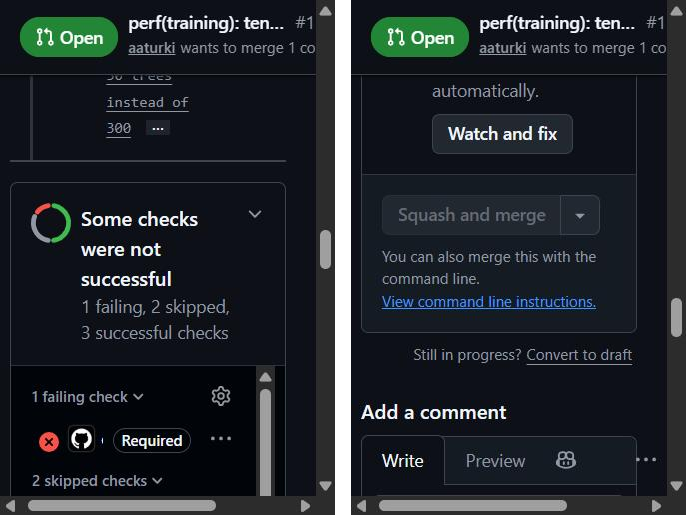

# Project journal · سجل المشروع

**Group · المجموعة:** Turki, working alone (the workshop allows groups of any size). The AI
coding agent is Claude Code with Claude Opus 5.5. The agent drafted each entry from what it
ran and saw; Turki checks and edits every entry.
**Track · المسار:** fraud
**Repository · المستودع:** https://github.com/aaturki/aie113-projects

---

## Stage 0: Track and model · المسار والنموذج

**What we asked the agent · ما طلبناه من الوكيل**
Read AGENTS.md, GUIDE.md and tracks/fraud/README.md, explain the model in plain words, and keep
only the fraud track in this repository.

**What it built · ما بناه**
- Removed `tracks/stocks/` and `tracks/vision/`. Nothing else changed yet.

**What we checked, and what we saw · ما تحققنا منه وما رأيناه**
The agent read the notebook's code and the outputs saved in it:
- 284,807 card payments over two days, 492 of them fraud: about 1 in 580.
- Inputs: `V1` to `V28` (anonymous numbers the bank mixed from the real details), `Amount`,
  and the hour of the day made from `Time`. The answer it learns: `Class`, 1 for fraud.
- Split by time, never shuffled: training 170,884 payments (360 frauds, hours 0 to 33.4),
  validation 56,961 (57 frauds), test 56,962 (75 frauds).
- The model: gradient boosting, 300 small trees.
- The alert threshold 0.4 is chosen on the validation part by the fraud team's rule: at least
  8 of every 10 alerts must be real fraud (at 0.4: 51 alerts, 41 frauds).
- On the test part, which the model never saw: 65 alerts, 56 of the 75 frauds caught (74.7%),
  86.2% of alerts are real fraud, 9 honest payments flagged, average precision 0.789.
- Baselines: always answering "not fraud" is 99.87% accurate and catches nothing; the rule
  "alert above 1,000" raises 503 alerts and catches 2 frauds.
- The payment in the last cell scores 0.999. Its reasons: if V14 were typical the score would
  fall to 0.149, V10 to 0.278, V4 to 0.983.

Still to do by Turki: run the notebook in Colab (Runtime, Run all) and compare these numbers.

**What surprised us or went wrong · ما فاجأنا أو ما تعثرنا فيه**
Accuracy is useless here: a model that never alerts is 99.87% accurate. And the "big amount"
rule fails because most frauds in this data are small amounts.

**How we would explain this stage to a colleague · كيف نشرح هذه المرحلة لزميل**
The model gives each card payment a fraud score from 0 to 1. Above 0.4, the payment goes to
the fraud team with the three inputs that pushed the score up the most. It learned from the
first day and a half and was judged on the last hours, like a bank that learns from the past
and is tested on the future. It catches three frauds in four, and six alerts in seven are real
fraud. Because fraud is so rare, we judge it by those two questions, never by accuracy.

**Open questions · أسئلة ما زالت مفتوحة**
- The guide wants allow, review and block. The notebook has one threshold (review). A second,
  higher threshold for block is a business rule we must choose and justify. (Answered in
  Stage 2: 0.9.)
- Where does the trained model live, if it may not go into git? (Stage 3.)

---

## Stage 1: Reorganise the notebook · إعادة تنظيم الدفتر

**What we asked the agent · ما طلبناه من الوكيل**
Propose a structure with one job per folder. Save every answer the notebook printed before
moving any code, then move the code and prove the new code gives the same answers. Keep the
data and the model out of git.

**What it built · ما بناه**

```
src/fraud_alerts/
  domain/     the words and rules of the problem: a payment and its 30 inputs, the
              allow / review / block rule, the "what if this input were typical?" reasons
              rule. Standard library and pydantic only.
  service/    the use case "assess one payment" (alerts.py), and what it needs from any
              model (interfaces.py: a version, a review threshold, typical values, scores).
  adapters/   the tools: model_bundle.py loads the scikit-learn model and its facts. The
              only serving code that touches joblib, pandas or scikit-learn.
  training/   the notebook's steps as a script: download, split by time, train, choose the
              threshold, check the quality gates, save, compare with the notebook.
golden/       notebook_answers.json: every answer the notebook printed, copied first.
.github/workflows/model.yml    trains on GitHub's computer and runs the comparison.
```

- Import directions, checked by a tool (import-linter) on every run: api → adapters →
  service → domain, never backwards. `training/` sits outside the layers, as the notebook did.
- Where things live:
  - the data: `data/`, downloaded by `training/data.py` and ignored by git;
  - the rules: `domain/`;
  - the model: `artifacts/`, made by `training/train.py`, loaded by
    `adapters/model_bundle.py`, ignored by git;
  - the configuration: training's settings are the constants at the top of
    `training/train.py` (the notebook's constants cell); the service's settings are in
    `config.py` (Stage 2).

**What we checked, and what we saw · ما تحققنا منه وما رأيناه**
- The golden check, in
  [this run](https://github.com/aaturki/aie113-projects/actions/runs/45390270037): **62 of 62
  answers the same.**
  - The 14 rows of the threshold table on the validation payments (at 0.4: 51 alerts, 41
    frauds), and the chosen threshold, 0.4.
  - The test counts, exactly: 65 alerts, 56 frauds caught, 9 false alarms, 19 missed. The
    average precision: 0.7887 (the notebook prints 0.789).
  - Three payments the notebook explained: its last cell, the first fraud caught in the test
    period, and the first false alarm. For each: the score, the top three reasons in order, and
    each reason's numbers.
  - For example, the last cell scores 0.9989 (notebook 0.999). If V14 were typical, the score
    would be 0.1486 (notebook 0.149); for V10, 0.2783 (0.278); for V4, 0.9830 (0.983).
  - The tolerance is half of the last printed digit (0.0005), the most that rounding can hide.
- All 56,962 test payments were scored a second time through the service's own path (a
  `Payment`, its `features()`, the bundle). The largest difference from the training path is
  0.0, with the same 65 alerts. Training and serving build the model's inputs the same way.
- The domain files import only the standard library and pydantic. The layer tool reports
  "Contracts: 4 kept, 0 broken".
- No notebook is needed: `python -m fraud_alerts.training.train` downloads, trains (5.5 s) and
  compares. The whole job takes under a minute.

Still to do by Turki: open `src/fraud_alerts/domain/policy.py` and find the two thresholds,
then open the run above and find the line "matches the notebook: True".

**What surprised us or went wrong · ما فاجأنا أو ما تعثرنا فيه**
- The numbers came back exactly, not approximately. The library versions are pinned and
  training uses one thread (`OMP_NUM_THREADS=1`), so the same data gives the same model.
- A dry run on made-up data shaped like the real file, before the first push, found two
  bugs:
  - a division by zero when the amount rule raised no alert;
  - the model file written before its facts were computed, so a crash would have left half a
    model.

  Both are fixed.
- A mistake: the first commit included build files that pip makes (`src/fraud_alerts.egg-info`).
  The next commit removed them, and git now ignores them.
- Training runs on GitHub's computer, not the laptop: the data is 150 MB, and Windows Smart App
  Control blocks some developer tools on this laptop.

**How we would explain this stage to a colleague · كيف نشرح هذه المرحلة لزميل**
We split the notebook into drawers with one job each. The rules drawer knows nothing about
scikit-learn, so swapping the model touches only the adapter drawer, and swapping the web
framework touches only the API. Before moving anything, we copied every answer the notebook
printed; after moving, the new code gave the same 62 answers. We chose clean architecture
because the track's two rules, the threshold and the reasons, must stay true whatever model or
web framework we use, and the layers let a tool check the import directions on every change.

**Open questions · أسئلة ما زالت مفتوحة**
- A newer scikit-learn would move these numbers slightly. The golden check would then fail on
  purpose, and we would write down why before accepting the new answers.

---

## Stage 2: The API · واجهة البرمجة

**What we asked the agent · ما طلبناه من الوكيل**
Design the request and the response before writing code, then put a versioned FastAPI endpoint
in front of the service. Show what a wrong or missing field gets back, and explain health
versus readiness.

**What it built · ما بناه**
- The routes:
  - `POST /v1/assess`: one payment in. Out: the fraud score, the decision, both thresholds,
    the hour the model used, the top three reasons, the model version and a trace id.
  - `GET /v1/health`: is the process alive?
  - `GET /v1/ready`: is the model loaded, and with which thresholds?
  - `/docs`: the contract, with the notebook's last payment as the example.
- The request (`api/schemas.py`): `timestamp`, `Amount`, `V1` to `V28`.
  - Amount and the V numbers keep the dataset's names, so a reason names exactly a field that
    was sent.
  - A real timestamp replaces the dataset's `Time` (the track README's suggestion): ISO 8601
    text with a time zone. Its hour is read on the bank's clock (`FRAUD_BANK_TIMEZONE`,
    Riyadh by default), so the same moment written in two time zones gets the same hour.
  - Strict. These are refused:
    - a number sent as text, true or false, NaN or Infinity;
    - a negative amount;
    - a missing field or an unknown field;
    - a timestamp without a time zone.
- The decision:
  - **allow** below 0.4.
  - **review** from 0.4: the model's threshold, the fraud team's rule.
  - **block** from 0.9: our business rule, in `config.py`. On the validation payments, 38 of
    the 39 payments scoring 0.9 or more were fraud. Block means "stopped now, and the fraud
    team is told"; a person still confirms, as the track README requires.
- One error shape for every failure, which never contains the values that were sent.
- Settings in one place (`config.py`, read from `FRAUD_` variables). The model loads once, at
  start-up. Each event is one JSON log line with its trace id, and no payment values.
- `scripts/smoke.py`: one good, one typical and three bad requests, against any running
  service.

**One good request and its response** (the real model, in
[this run](https://github.com/aaturki/aie113-projects/actions/runs/45390270037); numbers rounded
here, the API sends full precision):

```
POST /v1/assess        X-Trace-Id: smoke-1
{"timestamp": "2026-11-24T18:51:18+03:00", "Amount": 1504.93,
 "V1": -1.6002, "V2": -3.4881, ..., "V28": 0.4778}

200
{"score": 0.99886, "decision": "block", "review_threshold": 0.4, "block_threshold": 0.9,
 "hour": 18,
 "reasons": [{"input": "V14", "value": -6.106, "typical": 0.094, "score_if_typical": 0.1486},
             {"input": "V10", "value": -4.441, "typical": -0.110, "score_if_typical": 0.2783},
             {"input": "V4", "value": 3.247, "typical": 0.121, "score_if_typical": 0.9830}],
 "model_version": "1.0.0", "trace_id": "smoke-1"}
```

These are the notebook's reasons and numbers for its last cell. A typical payment, with every
input at its typical value, scored 0.000005: allowed, with no reasons.

**One bad request and its error** (Amount sent as the text "1504.93"):

```
422
{"error": {"code": "invalid_request",
           "message": "The request does not match the contract: see problems, and /docs.",
           "problems": [{"field": "Amount", "problem": "Input should be a valid number"}]},
 "trace_id": "9a14318df97747ddb78f8fb969fc0a06"}
```

It names the field and the problem, never the value sent.

**What the readiness check looks at · ما يفحصه فحص الجاهزية**
At start-up the service loads the model and its facts from `artifacts/` and checks three
things:
1. The model expects the 30 inputs the service sends, in the same order.
2. The model was saved with the scikit-learn version the service runs.
3. The thresholds make sense: 0 < review ≤ block ≤ 1.

If any check fails, the service stays up, `/v1/ready` answers 503, and the log says why.
`/v1/health` only says the process answers. A frozen process fails health and gets
restarted; a service without its model fails readiness and gets no traffic.

**What surprised us or went wrong · ما فاجأنا أو ما تعثرنا فيه**
- The first local run echoed an unknown field named `card_number_4111111111111111` in the
  error and in the log. Data can hide in a field's name, not only in its value. Unknown names
  are now shown only if they contain no run of four or more digits. The smoke test checks
  this, and the pipeline checks that the log holds no payment value.
- Two defaults were too kind, and both are refused now:
  - the timestamp accepted a bare number (seconds or milliseconds? in which time zone?);
  - Python's JSON reader accepts NaN.
- An allowed payment needs no reasons, so the service skips the 30 extra what-if scores for
  almost every payment (99.9% of the test payments are allowed).

**How we would explain this stage to a colleague · كيف نشرح هذه المرحلة لزميل**
The API is the service's only door. A client sends one payment in a fixed shape and gets back
a score, a decision and the reasons. Anything that does not match the shape is turned away at
the door with a clear and safe message, before our code runs. Health says "I am alive";
readiness says "I have my model and can answer".

**Open questions · أسئلة ما زالت مفتوحة**
- Which clock gives a payment its hour? The model learned its hours from two days of 2013
  European data, assuming the file started at midnight. We read the hour on the bank's clock,
  Riyadh by default. It is a setting, and a real bank would check it against its own data.

---

## Stage 3: The container · الحاوية

**What we asked the agent · ما طلبناه من الوكيل**
Write a Dockerfile and explain every line. Lock the libraries. Keep the image slim and
non-root, with no secrets, and a health check on readiness. One command must start it. Then:
how big is it, what makes up most of it, and where should the model live?

**What it built · ما بناه**
- `requirements.lock`: all 27 libraries the service runs on, at their exact versions. The
  image and the training job both install exactly this list, then `pip check` fails if a
  library is missing. So the model is trained and served on the same libraries.
- `Dockerfile`, in two stages:
  - **builder**: installs the locked libraries into a virtual environment;
  - **runtime**: copies only that environment, then the model, then the code. The rarely
    changed parts come first, so a code change rebuilds only one small layer.

  The base image is pinned by its digest, with Debian's security fixes applied. The service
  runs as a normal user (`app`, uid 10001), with no pip and no curl. The health check calls
  `/v1/ready`, so "healthy" means "model loaded", not just "process running".
- `.dockerignore`, an allow-list: only the lock, `src/` and the model reach the build. A
  `.env` file, a key or the data can never be packed by mistake.
- `compose.yaml`: `docker compose up --build --wait` starts it. The service runs read-only,
  with no Linux capabilities and no way to gain privileges.
- `ci.yml` (replacing `model.yml`): the model job hands the model it checked to an image job.
  The image job builds, measures, rebuilds after a one-line change, starts the service with
  compose, waits for "healthy", runs the smoke test through the container, and checks what is
  inside.

Docker is not installed on this laptop, so the image is built and run on GitHub's computer.
Every number below comes from
[this run](https://github.com/aaturki/aie113-projects/actions/runs/45391778041).

**What we checked, and what we saw · ما تحققنا منه وما رأيناه**

| Question | Answer |
|---|---|
| Image size | 165 MB to download. The libraries are 383 MB of it unpacked: scipy 109 MB, pandas 81 MB, numpy 66 MB, scikit-learn 49 MB. The model is 0.6 MB and our code 0.1 MB. |
| Build time, nothing cached | 33.2 s |
| Rebuild after a one-line code change | 0.22 s: Docker reused every step except copying the code |
| Start to healthy | 6 s |
| Runs as | `uid=10001(app)`, not root |
| What else is inside | no pip, no curl, no secret-like variable; its own files are read-only |
| Through the container | the Stage 2 answers again: block at 0.99886 with V14 first; the typical payment allowed; three bad requests refused |

**Where the model lives · أين يعيش النموذج**
Inside the image, at `/app/artifacts`. Why:
- It is 0.6 MB, so the image barely grows.
- Each image holds exactly one model that passed every check, so the image's tag tells which
  model is running.
- Start-up depends on no download and no network.
- Going back to an old model means running the old image.

The cost: a new model needs a new image, and the pipeline builds one on every change anyway.
The model is still never in git: the model job trains it on GitHub, compares it with the
notebook, and hands it to the image job.

**What surprised us or went wrong · ما فاجأنا أو ما تعثرنا فيه**
- Our own "no secrets inside" check failed on its first run, on `GPG_KEY`. The official
  Python base image sets this variable to the **public** fingerprint of the key that signs
  Python's releases, which python.org publishes. It is not a secret, so the check now allows
  that one name with exactly that value, and the reason is written next to it. Any other
  secret-like variable still fails.
- The first rebuild timing said "0 s": whole seconds were too coarse. In milliseconds it is
  218 ms.
- The image is mostly scientific libraries. pandas (81 MB) only hands the model a table, so
  serving without it would shrink the image. We did not do it: training and serving on
  exactly the same libraries is worth more to us than 81 MB.

**How we would explain this stage to a colleague · كيف نشرح هذه المرحلة لزميل**
The image is a sealed box: the service, its libraries at exact versions, and the model. It is
packed once and runs the same on any computer. It runs as a normal user, cannot change its
own files, and says it is healthy only when the model is loaded. Because the libraries are
packed before the code, changing a line of code repacks in a fraction of a second.

**Open questions · أسئلة ما زالت مفتوحة**
- Turki has not yet run the image on his own machine. On any machine with Docker: put the
  model in `artifacts/` (see the README), then run `docker compose up --build --wait`.

---

## Stage 4: Tests · الاختبارات

**What we asked the agent · ما طلبناه من الوكيل**
List the tests by level, each in one plain sentence, before writing them. Say which ones
would catch a model that silently got worse. Break something on purpose and show which test
catches it. Run everything, and say what is not tested.

**What it built · ما بناه**
104 tests, plus the golden check that runs inside every training, and the smoke test.

| Level | Where | How many | What they protect |
|---|---|---|---|
| Unit | `tests/unit/` | 46 | The rules, alone, with a stand-in model that gives known scores. |
| Integration | `tests/integration/` | 34 | The API as a client sees it, with the stand-in model. |
| Model behaviour | `tests/model/test_behaviour.py` | 10 | How the real model behaves. |
| Golden | `tests/model/test_golden.py`, and `training/golden.py` in every training run | 3, and 62 answers | The notebook's answers. |
| Quality floor | `tests/model/test_quality.py` | 3 | The agreed minimum on the 56,962 test payments. |
| Data checks | `tests/data/test_data.py` | 8 | The downloaded file is what we expect. |
| Smoke | `scripts/smoke.py` | 15 checks | The container really starts and answers. |

The tests in plain words:

- **Unit**
  - The decision flips exactly at 0.4 and at 0.9.
  - Thresholds that make no sense, and wrong settings, stop the start.
  - The hour follows the notebook's rule. The same moment in three time zones has one hour.
  - The inputs come out in the order the model learned them.
  - An impossible payment is refused: negative, NaN, hour 24, 27 numbers instead of 28.
  - Reasons are ranked by how far the score falls, at most three, and only inputs that
    lower the score.
  - An allowed payment costs one model call; an alert costs one more batched call of 30
    what-ifs.
  - The adapter refuses a model with other inputs, or saved by another scikit-learn.
- **Integration**
  - Every kind of bad request is refused with the field named: a number as text, true, NaN,
    Infinity, a negative or absurd amount, null, a missing field, an unknown field, a
    timestamp without a time zone or as a bare number, a body that is not a payment, an
    oversized body.
  - Errors never repeat the values sent, and a field name that could hold a card number is
    not repeated.
  - A crash says nothing about its cause.
  - Health, readiness, and "not ready" when the model is missing or the thresholds are wrong.
  - The log holds the decision but no payment value.
- **Model behaviour**
  - Making the top reason typical lowers the score.
  - Every reason names a real input and lowers the score.
  - The day does not matter, only the hour. The same moment written in UTC gets the same
    score.
  - The typical payment is allowed.
  - The same payment always gets the same score.
- **Golden**: the notebook's three payments, sent through the API, get the notebook's
  scores and reasons.
- **Quality floor**
  - At least 70% of frauds caught, with at least 80% of alerts real fraud.
  - Better than both baselines.
  - Every one of the alerts has a reason that lowers its score.
- **Data checks**
  - The exact file (its sha256), the columns, 284,807 rows and 492 frauds.
  - Nothing missing, and every value inside the limits the API accepts.
  - No future payment in training.
  - The hour built by the domain's rule, and the golden rows unchanged.

The fast tests (unit and integration) run on every change, on any laptop. The model and data
tests need the trained model and the 150 MB data, so they run in the pipeline's model job
right after training. On a laptop without them they are skipped and the reason is shown. In
the pipeline (`CI=true`) a missing model or data file fails instead, so these checks cannot
be switched off there unnoticed.

**What we checked, and what we saw · ما تحققنا منه وما رأيناه**
- Run times, in
  [this run](https://github.com/aaturki/aie113-projects/actions/runs/45394070428):
  - fast suite: 80 passed in 1.03 s (0.92 s on the laptop), covering 100% of the service's
    lines and branches; the pipeline requires at least 95%;
  - model and data suite: 24 passed in 3.57 s, after a 5 s training.
- **The deliberate break.** In `domain/policy.py`, `score >= review_at` became
  `score > review_at`, so a payment scoring exactly 0.4 would be allowed. One test caught it:

  ```
  FAILED tests/unit/test_policy.py::test_the_decision_flips_exactly_at_each_threshold[0.4-review]
  AssertionError: assert <Decision.ALLOW: 'allow'> is <Decision.REVIEW: 'review'>
   +  where <Decision.ALLOW: 'allow'> = decide(0.4, Thresholds(review_at=0.4, block_at=0.9))
  1 failed, 79 passed
  ```

  We undid the change and all 80 passed again. Only the test sitting exactly on the boundary
  noticed; every other test still passed. That is why boundary tests matter.
- **Which tests catch a model that silently got worse:**
  - the golden check (62 answers) in every training;
  - the golden API tests;
  - the quality floor, and the baselines test;
  - "every alert has a reason that lowers its score".

  The fast tests would not catch it, by design: they use a stand-in model, so they test our
  code.
- **Not tested by the fast suite:** `training/`. It is checked end to end instead, by the
  model job on the real data (the golden check and the slow tests). The part that worries us
  most cannot be tested by code at all: the assumption that the model's hour means the hour on
  the bank's clock.

**What surprised us or went wrong · ما فاجأنا أو ما تعثرنا فيه**
- The first pipeline run reported 16 model and data tests, not 23. `.gitignore` said `data/`,
  which hides every folder named `data`, so `tests/data/test_data.py` had never been committed.
  We noticed only because the count was smaller than expected. Now `/data/` and `/artifacts/`
  match only the top-level folders.
- A stand-in model is what keeps the fast tests fast and honest. Its rule is "a low V14 is
  suspicious", so a test failure always means our code changed, never the model.
- Starlette warned that its test client now wants `httpx2`. We switched instead of hiding the
  warning.

**How we would explain this stage to a colleague · كيف نشرح هذه المرحلة لزميل**
Two kinds of tests guard two kinds of failure. Fast tests with a pretend model check that our
code still follows the rules: thresholds, errors, privacy. They run in a second, so we run
them all the time. Slow tests with the real model and the real data check that the model still
gives the notebook's answers and still catches enough fraud. A model can be wrong while every
line of code "works", and only these tests would see it.

**Open questions · أسئلة ما زالت مفتوحة**
- The test period has only 75 frauds, so the quality floor moves by more than one point per
  fraud. A bigger reference set would make it steadier.

---

## Stage 5: The pipeline · خط التشغيل الآلي

**What we asked the agent · ما طلبناه من الوكيل**
Write a GitHub Actions workflow with lint, test, image build, smoke test and publish, and
explain each job and when it runs. Give every job the fewest permissions it needs. Switch on
branch protection for main. Then open a pull request with a deliberate mistake and watch the
merge get blocked.

**What it built · ما بناه**
`.github/workflows/ci.yml` runs on every push to main and on every pull request. Times are
from [this run on main](https://github.com/aaturki/aie113-projects/actions/runs/45396089859):

| Job | What it checks | Waits for | Time |
|---|---|---|---|
| secrets | Gitleaks over every commit ever made: a deleted secret still lives in the history | nothing | 11 s |
| lint | ruff (style and simple mistakes), mypy in strict mode (types), lint-imports (the layer rules) | nothing | 49 s |
| test | the 80 fast tests; coverage must stay at least 95% | nothing | 32 s |
| model | trains on the real data; the 62 notebook answers; the 24 model and data tests; the smoke test on the fresh model | nothing | 56 s |
| image | build, size, rebuild time, start with compose until healthy, smoke test through the container, not root, nothing extra inside, then Trivy: a HIGH or CRITICAL vulnerability with a fix, or a secret, in the image fails | model | 1 min 20 s |
| publish | pushes the image to GitHub's registry, tagged with the commit and `main`, with a signed record of how it was built | all five; main only | 1 min 12 s |

The first four jobs run side by side, so a full run takes about three and a half minutes.

- **Permissions.** Every job may only read the code (`contents: read`). Only publish may
  write packages and ask for an OIDC identity. OIDC means GitHub vouches for the workflow
  with a short-lived token, which signs the build record, so no signing key is stored
  anywhere.
- **Pinned actions.** Every action is pinned to a commit SHA, not to a tag that could be
  moved to other code.
- **No secret in any workflow file.** The registry login uses the job's own short-lived
  `GITHUB_TOKEN`.

**Branch protection on main.** It was set through GitHub's API. In the website it is
Settings → Branches → Add branch protection rule → `main`. The rules:
- every change arrives through a pull request;
- the five checks (secrets, lint, test, model, image) must pass, on a branch that is up to
  date with main;
- the rules apply to admins too, so Turki cannot push around them;
- history stays linear: no force-push, no deletion.

**What we checked, and what we saw · ما تحققنا منه وما رأيناه**
- **The blocked pull request.**
  [Pull request #1](https://github.com/aaturki/aie113-projects/pull/1) changed one number in
  `training/train.py`: 300 trees became 30, "ten times faster". Every line of code still ran,
  and lint, test and secrets all passed. The model job stopped it:

  ```
  chosen threshold: 0.8
  test: {"alerts": 56, "frauds_caught": 51, "precision": 0.9107, "recall": 0.68, ...}
  FAILED the quality gates (recall >= 0.7, precision >= 0.8): the model is not saved
  ```

  The image job never ran. GitHub reported the merge state as BLOCKED: "Some checks were not
  successful", and the merge button was disabled.

  

  Then a second commit in the same pull request put back the notebook's 300 trees. Every check
  passed again, and the pull request was merged. The mistake and its fix both stay in the
  history.
- **The image's address:** `ghcr.io/aaturki/aie113-projects:<commit>`, and
  `ghcr.io/aaturki/aie113-projects:main` for the newest. For example
  `ghcr.io/aaturki/aie113-projects:7d8949a164e3a899e81a7892dfccbb5d4d766fe9`, digest
  `sha256:2dc9e357dae4ba9cafb198c45b25ede5e2b6bcddda317d7bb27afabfe30847fe`. GitHub holds one
  signed build record for that digest. Anyone can check it with
  `gh attestation verify oci://ghcr.io/aaturki/aie113-projects:<commit> --owner aaturki`.

**What surprised us or went wrong · ما فاجأنا أو ما تعثرنا فيه**
- The weaker model looked better on one number. With 30 trees, 91% of its alerts were real
  fraud, more than the real model's 86%. But it caught only 68% of the frauds. The agreed
  gate (catch at least 70%) is what stopped it. Judging a model by a single number would
  have let it through.
- No code check could have seen this mistake. Only the job that trains and measures the
  model could.
- The first run of the history scan failed on our own line: the `GPG_KEY` value we had
  allowed in Stage 3 looks like a key to the scanner. It is public, so:
  - `.gitleaksignore` lists exactly that one finding, with the reason;
  - the image check was rewritten to compare with the base image instead of naming the
    value.

  We did not rewrite history or switch the scan off: any other finding still fails.

**How we would explain this stage to a colleague · كيف نشرح هذه المرحلة لزميل**
The pipeline is a checklist that runs on every change, and people forget steps but it never
does. Secrets, style, fast tests and the model run side by side. The image is built only from
a model that passed, and it is published only from main, after everything is green. Main is
locked: a change can only arrive through a pull request whose checks all passed. We proved it
with a deliberate mistake that every code check missed and the model check caught.

**Open questions · أسئلة ما زالت مفتوحة**
- Turki should check whether the image's package page on GitHub is public or private. If it
  is private, pulling the image needs a GitHub login.
